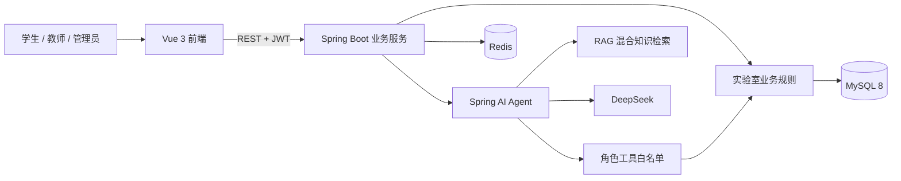

# 基于大语言模型 Agent 的校园实验室智能预约与安全管理平台

本项目是一个前后端分离的校园实验室管理平台，在实验室预约、教师审核、安全考试、信用管理和耗材库存等业务闭环之上，接入 Spring AI Tool Calling 与 RAG，为学生、教师和管理员提供受角色约束、可追溯的智能助手。

系统不会让大模型直接访问数据库。模型只能调用后端注册的白名单工具，登录身份、数据范围、预约冲突、实验室准入、安全考试、信用分和库存数量均由 Java 事务再次校验；预约草稿和教师审核仍需要用户在业务页面确认。

## 技术栈

| 层次 | 技术 |
| --- | --- |
| 前端 | Vue 3.5、Vite 6、Element Plus 2.10、Pinia、Axios、ECharts |
| 后端 | Spring Boot 3.5、Spring AI 1.1.8、Spring Security、JWT、MyBatis-Plus |
| 基础框架 | RuoYi-SpringBoot3-Pro、RuoYi-SpringBoot3-ElementPlus |
| 数据存储 | MySQL 8、Redis |
| 智能模型 | DeepSeek Chat |
| 支撑环境 | JDK 21、Maven、Node.js 22 |

## 主要功能

- 学生预约：资格预检、实验室与设备选择、时间冲突校验、班级预约、预约草稿、签到、完成和取消。
- 教师审核：按负责班级查看待审核预约、学生考试与信用情况，并完成通过、驳回和弃审。
- 安全管理：实验室准入规则、安全考试题库、在线答题、成绩有效期、信用账户和违规记录。
- 资源管理：实验室、设备、班级负责人、安全题库、耗材库存和库存流水。
- 数据分析：按学生、教师和管理员角色展示数据看板。
- 智能助手：角色化对话、业务查询、安全知识问答、平台帮助、当前时段可约查询和受控预约草稿。
- Agent 治理：角色工具白名单、服务端身份校验、工具调用审计、知识库可见范围、管理员审计和在线评测。

## 系统架构



## 项目结构

```text
bishe_project
├── api/                     Spring Boot 多模块后端
├── ui/                      Vue 3 前端
├── docs/                    需求、设计、操作与介绍文档
├── sql/
│   ├── module/              业务增量与菜单 SQL
│   ├── module_core.sql      核心业务表
│   └── release/             一键初始化发布包
├── tools/                   构建与发布辅助脚本
└── README.md
```

## 快速开始

### 1. 环境要求

- JDK 17 或 21，本项目推荐 JDK 21
- Maven 3.6+
- Node.js 20+，推荐 Node.js 22
- MySQL 8
- Redis 6+

### 2. 初始化数据库

完整数据库初始化文件：

```text
sql/release/01-bishe_schema_full.sql
```

该文件会自动创建并使用 `bishe_schema`，包含：

- 若依基础表、账号、菜单和系统数据
- Magic API 运行表
- 中国行政区划基础数据
- 实验室、设备、预约、审核、考试和信用业务表
- 当前业务菜单、按钮、角色和演示账号
- 预约生命周期、耗材库存、数据看板
- Spring AI 会话、草稿、审计、知识库、平台帮助和评测数据

Linux/macOS：

```bash
mysql -u root -p --default-character-set=utf8mb4 < sql/release/01-bishe_schema_full.sql
```

Windows PowerShell：

```powershell
cmd /c "mysql -u root -p --default-character-set=utf8mb4 < sql\release\01-bishe_schema_full.sql"
```

也可以在 Navicat、DataGrip 或 IDEA 数据库工具中直接运行该文件。

注意：完整初始化文件会删除并重建同名基础表和业务表，只应在空数据库或确认可以清空数据的开发环境执行。详细说明见 [SQL 发布包说明](sql/release/README.md)。

### 3. 配置数据库和 Redis

开发配置位于：

```text
api/ruoyi-admin/src/main/resources/application-devmy.yml
```

当前激活的 profile 为 `devmy`，默认数据库名为 `bishe_schema`。MySQL JDBC 地址需要包含：

```text
allowPublicKeyRetrieval=true
```

Redis 默认使用：

```text
127.0.0.1:6379
```

### 4. 启动后端

在 IDE 启动前先复制资源文件，避免 `target/classes` 缺少配置或 Mapper：

```powershell
cd api
mvn -q -pl ruoyi-admin -am process-resources
mvn spring-boot:run -pl ruoyi-admin
```

后端默认地址：`http://localhost:8087`

### 5. 启动前端

```powershell
cd ui
npm install
npm run dev
```

本地页面通常为：`http://127.0.0.1:8090/admin/`

### 6. 配置 DeepSeek

推荐在已被 Git 忽略的 `api/ruoyi-admin/application-local.yml` 中填写：

```yaml
bishe:
  ai:
    deepseek-api-key: "在这里填写本地 Key"
```

也可以在后端启动环境中设置：

```text
DEEPSEEK_API_KEY=在这里填写本地 Key
```

修改后需要重启后端。真实 Key 不得提交到 Git、写入 SQL 或放入截图。

未配置 Key 时，会话管理、知识库检索、Agent 审计和离线评测仍可使用，但真实模型对话不可用。

## 演示账号

数据库初始化后会提供管理员、学生和教师演示账号：

| 角色 | 用户名 |
| --- | --- |
| 管理员 | `admin` |
| 学生 | `stu101`、`stu201`、`stu301` 等 |
| 教师 | `teacher101`、`teacher201`、`teacher301` |

初始密码沿用若依基础数据中的管理员口令，首次登录后应立即修改。仓库不保存明文密码。

## 智能助手能力边界

- 不同角色使用不同的系统提示词和工具白名单。
- 用户角色始终从 JWT 登录上下文获取，不能由模型参数切换。
- 学生只能生成预约草稿，必须在预约页面确认提交。
- 教师助手只整理审核依据，审核结果必须在审核页面确认。
- 工具调用记录会话、用户、参数、返回、成功状态和耗时。
- 知识库按知识类型、启停状态和角色可见范围过滤。
- RAG 使用中文关键词、TF-IDF、结构匹配和本地特征哈希向量，不依赖外部向量数据库。

## 测试与构建

后端测试和编译：

```powershell
cd api
mvn -B -pl ruoyi-admin -am test
```

前端生产构建：

```powershell
cd ui
npm run build:stage
```

## 文档

- [系统功能介绍手册](docs/07-系统功能介绍手册.md)
- [系统操作手册](docs/08-系统操作手册.md)
- [本地开发指导书](docs/04-本地开发指导书.md)
- [需求规格说明书](docs/01-需求规格说明书.md)
- [系统概要设计说明书](docs/02-系统概要设计说明书.md)
- [接口设计说明书](docs/03-接口设计说明书.md)
- [SQL 发布包说明](sql/release/README.md)

## 安全注意事项

- 不要提交数据库口令、DeepSeek Key、`application-local.yml`、用户数据和日志。
- 不要提交 `target/`、`dist/`、`node_modules/` 和本地浏览器验证产物。
- 演示完成后应清理测试预约、耗材和临时知识库数据。
- 正式部署时应启用 HTTPS，并修改默认密码和示例密钥配置。

## 开发约定

详细协作规范见 [AGENTS.md](AGENTS.md)，命名口径以 [命名规范-最终版.md](命名规范-最终版.md) 为准。
