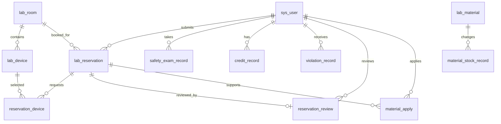

# 数据库设计说明

## 一、设计范围

本设计先覆盖第一期可运行闭环：登录与角色、实验室和设备、预约申请、教师审核、安全考试和信用分。耗材、签到、违规、统计与 AI 对话日志均预留数据表，后续按功能逐步启用。

所有业务表均使用 `BIGINT` 主键，并保留 `create_time`、`update_time`；逻辑删除字段只在需要保留历史的表中使用。时间统一使用 `DATETIME`，金额或数量等精确小数使用 `DECIMAL`，不用浮点数。

## 二、核心关系

## 三、表清单

| 类别 | 表名 | 用途 | 第一期 |
| --- | --- | --- | --- |
| 权限 | `sys_user` | 学生、教师、管理员账号 | 是 |
| 权限 | `sys_role` | 角色字典 | 是 |
| 权限 | `sys_user_role` | 用户角色关联 | 是 |
| 实验室 | `lab_room` | 实验室、容量、开放时段、安全等级 | 是 |
| 实验室 | `lab_device` | 设备、所属实验室和使用状态 | 是 |
| 预约 | `lab_reservation` | 预约主记录及状态流转 | 是 |
| 预约 | `reservation_device` | 预约申请的设备 | 是 |
| 预约 | `reservation_review` | 教师审核意见与审核人 | 是 |
| 安全 | `safety_question` | 安全考试题库 | 是 |
| 安全 | `safety_exam_record` | 考试成绩、通过状态和有效期 | 是 |
| 信用 | `credit_record` | 信用分加减流水 | 是 |
| 耗材 | `lab_material` | 耗材库存 | 否 |
| 耗材 | `material_apply` | 耗材领用申请 | 否 |
| 耗材 | `material_stock_record` | 库存变动流水 | 否 |
| 实验过程 | `experiment_checkin` | 实验签到 | 否 |
| 实验过程 | `experiment_finish_check` | 结束检查 | 否 |
| 违规 | `violation_record` | 违规与处理记录 | 否 |
| AI | `chat_session` | 用户会话 | 后期 |
| AI | `chat_message` | 对话消息和引用来源 | 后期 |
| AI | `tool_call_log` | Agent 工具调用审计 | 后期 |

## 四、关键字段与业务规则

### 4.1 预约主表 `lab_reservation`

| 字段 | 类型 | 说明 |
| --- | --- | --- |
| `id` | BIGINT | 主键 |
| `reservation_no` | VARCHAR(32) | 预约编号，唯一 |
| `student_id` | BIGINT | 申请学生 |
| `lab_room_id` | BIGINT | 预约实验室 |
| `experiment_name` | VARCHAR(100) | 实验名称 |
| `experiment_type` | VARCHAR(30) | 实验类型，例如 CHEMISTRY/BIOLOGY |
| `start_time`、`end_time` | DATETIME | 使用时段，开始必须早于结束 |
| `participant_count` | INT | 参与人数，不能超过实验室容量 |
| `risk_level` | TINYINT | 1 普通，2 中风险，3 高风险 |
| `status` | VARCHAR(20) | `PENDING`、`APPROVED`、`REJECTED`、`CANCELED`、`COMPLETED` |
| `need_teacher_review` | TINYINT | 是否进入教师审核 |
| `remark` | VARCHAR(500) | 实验说明 |

后端必须校验：同一实验室在重叠时段不能存在 `PENDING` 或 `APPROVED` 预约；学生安全考试在有效期内；信用分高于预约阈值；高风险实验必须教师审核。数据库索引能加速查询，但时间重叠判断仍由后端事务完成。

### 4.2 权限建议

第一版仅使用三种角色：`STUDENT`、`TEACHER`、`ADMIN`。不要一开始照搬复杂的菜单、部门、岗位、数据权限体系。若后面确定使用若依，再按其现有表结构适配，本 SQL 中的 `sys_user`、`sys_role`、`sys_user_role` 可替换为若依对应用户体系。

### 4.3 初始模拟数据

第一批录入：3 个管理员/教师账号、20 个学生、8 间实验室、30 台设备、60 条预约记录、20 条考试记录。全部使用虚构姓名、学号与实验室编号；在论文中注明为模拟测试数据。
